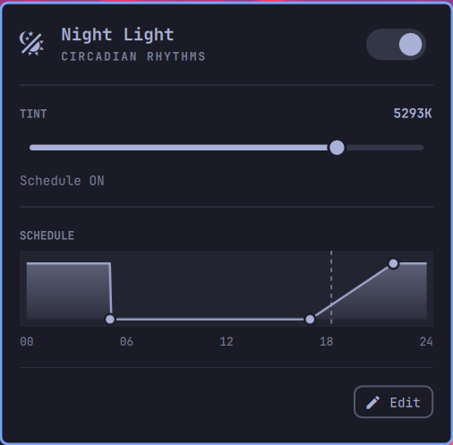

# Night Light Schedule for Omarchy

A night light panel for the Omarchy bar with a fully customisable 24-hour schedule. It replaces the built-in `omarchy.nightlight` toggle.



## Features

- **Tint slider** from 1000K to 6500K. Moving it while the schedule is on holds that tint until the next schedule point, and a *Resume schedule* button returns control early.
- **24h schedule** shown as a timeline. You can add as many points as you like, and each point *arrives* by:
  - **Jump**: change at that time.
  - **Fade**: glide smoothly from the previous point, in 1K steps.
  - **Steps**: move every *N* minutes.
- **Edit → Save**: changes are a draft until you press Save.
- **Schedule switch** in the panel header, which is remembered across reboots. With the schedule off the screen is untinted, but the slider still works.
- Uses theme colours only, so the panel follows your Omarchy theme.
- Right-click the bar icon to toggle the schedule.

The default schedule is 6500K until 17:00, then a fade to 1500K by 22:00 that holds until 05:00.

## Install

```bash
omarchy plugin add https://github.com/Albertus-de-Klerk/omarchy-nightlight-schedule.git --enable
omarchy plugin disable omarchy.nightlight
omarchy restart shell
```

## Command line

```bash
omarchy-shell nightlight status      # JSON: enabled, temperature, scheduled, override
omarchy-shell nightlight enable|disable|toggle
omarchy-shell nightlight set 3000    # manual tint until the next point
omarchy-shell nightlight resume
```

Settings are stored in `~/.config/omarchy/nightlight.json`. The file is watched, so edits you make by hand apply live.

## Requirements

Omarchy 4.5+ with `hyprsunset`. Tested on Omarchy 4.5.0.

## Development

The schedule maths lives in `Schedule.js`, which has no QML in it: `node tests/schedule.test.js`.
